# Shahin Video Analytics Dashboard — Complete User & Technical Guide

The **Shahin Video Analytics Dashboard** provides an end-to-end view of how videos on your website are discovered, watched, delivered, and monetized. Rather than looking at raw play counts in isolation, it connects five stages of the video lifecycle into a single workspace:

1. **Organic Search Discovery** — How videos surface in Google Search, earn clicks, and convert into plays (via Google Search Console).
2. **Viewer Engagement & Watch Depth** — How long viewers stay, how much of each video they finish, how playback starts, and where audiences drop off.
3. **Streaming Quality of Experience (QoE)** — Stalls, startup playback errors, watched vs. downloaded resolutions, and adaptive bitrate (ABR) downgrades.
4. **Audience Environment** — Which devices, operating systems, browsers, and device brands watch your videos—and which ones suffer from buffering.
5. **Ad Monetization & Per-Video Diagnostics** — Pre-, mid-, and post-roll ad performance, followed by a searchable 500-video performance table with a full slide-over drill-down drawer for every individual video.

> **Reference Screenshots:** All screenshots in this guide were captured from the live production Shahin panel (`https://my.shahin.live/_cp/en/analytics/video`) using real traffic data over a **Last 28 Days** window.

---

## Table of Contents

1. [Accessing the Dashboard & Global Controls](#1-accessing-the-dashboard--global-controls)
2. [How Data Collection Works](#2-how-data-collection-works)
   - [Two Data Sources](#two-data-sources)
   - [Auto-Detected Video Players & Ad SDKs](#auto-detected-video-players--ad-sdks)
   - [Core Measurement Rules](#core-measurement-rules)
3. [Dashboard Sections (Top to Bottom)](#3-dashboard-sections-top-to-bottom)
   - [3.1 Hero KPIs](#31-hero-kpis)
   - [3.2 Search Visibility (Google Search Console)](#32-search-visibility-google-search-console)
   - [3.3 Watch Depth and Time](#33-watch-depth-and-time)
   - [3.4 Watch Time Trend & Exportable Table Drawer](#34-watch-time-trend--exportable-table-drawer)
   - [3.5 Playback Source](#35-playback-source)
   - [3.6 Completion Funnel](#36-completion-funnel)
   - [3.7 Completion Rate by Channel and Campaign](#37-completion-rate-by-channel-and-campaign)
   - [3.8 Playback Health (QoE), Quality Comparison & Adaptive Drops](#38-playback-health-qoe-quality-comparison--adaptive-drops)
   - [3.9 User Environment (Distribution & Trend)](#39-user-environment-distribution--trend)
   - [3.10 Ad Monetization & Ad Performance by Position](#310-ad-monetization--ad-performance-by-position)
   - [3.11 Videos Performance Table](#311-videos-performance-table)
4. [Per-Video Deep Dive: The Video Details Drawer](#4-per-video-deep-dive-the-video-details-drawer)
5. [Complete Page Interactions & UI Controls Reference](#5-complete-page-interactions--ui-controls-reference)
6. [Live Production Dashboard vs. Interactive Demo (v36)](#6-live-production-dashboard-vs-interactive-demo-v36)
7. [Metric Formula & Definitions Reference](#7-metric-formula--definitions-reference)
8. [Practical Playbooks by Team](#8-practical-playbooks-by-team)
9. [Important Thresholds, Edge Cases & Notes](#9-important-thresholds-edge-cases--notes)

---

## 1. Accessing the Dashboard & Global Controls

### Where to Find It
In the Shahin control panel (`my.shahin.live`), open the left sidebar and navigate to:

**`Analytics` → `Specialized Analysis` → `Video`**

The active site/project can be switched at any time using the **project selector dropdown** at the top left of the sidebar. Every report on the page immediately reloads for the selected project.

### Date Range Selector
In the upper-right corner of the page header, the **Date Range Selector** controls the analysis window for every card, chart, table, and per-video detail drawer on the page.

Available presets:
- **Last 7 Days**
- **Last 28 Days** *(default)*
- **Last Month**
- **Last 3 Months**
- **Last 6 Months**
- **Last 12 Months**
- **Last 16 Months**
- **Custom Range** *(choose any exact start and end calendar dates)*

The selected date window and project are synced to the URL query parameters, making filtered dashboard views easy to bookmark or share with teammates.

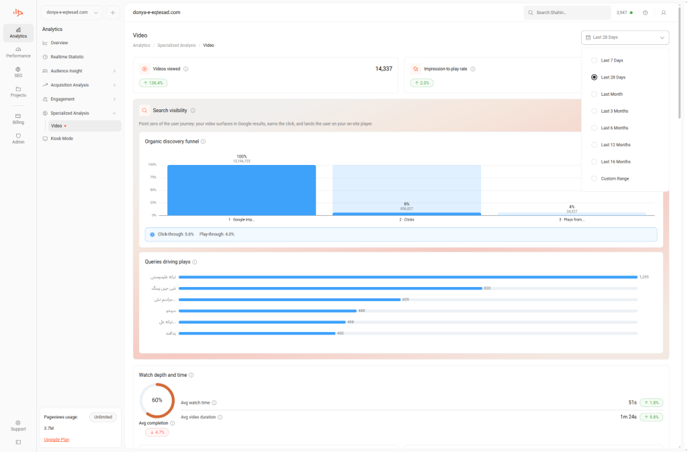

### Period-over-Period Comparison Deltas
Most KPI cards and share columns display a small percentage-change badge (for example, `↑ 35.3%` or `↓ 4.7%`). This badge always compares the selected date range against the **immediately preceding period of the exact same length** (e.g., Last 28 Days vs. the 28 days right before it).

- **KPI cards:** Relative percentage change: `(current − previous) / previous × 100`.
- **User Environment `Share` delta:** Percentage-point shift in share compared to the prior period.
- If there is no valid prior baseline (for example, a newly published video or a range starting before collection began), the delta is shown as `—` rather than a misleading `0%` or `+∞`.

---

## 2. How Data Collection Works

### Two Data Sources

The Video Dashboard combines two independent pipelines:

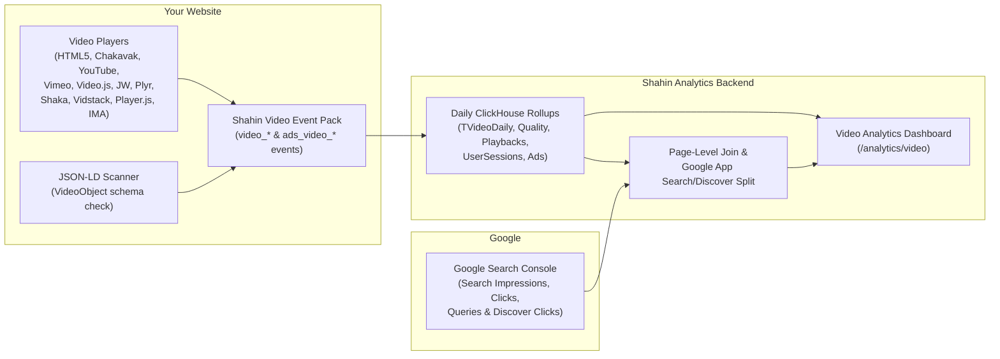

1. **Shahin On-Page Video Event Pack (primary source):** Powers every playback, engagement, quality, user-environment, ad-monetization, and per-video metric on the dashboard. Events are emitted automatically by Shahin's lightweight script and rolled up into daily archive tables.
2. **Google Search Console (GSC):** Powers the **Search visibility** band near the top of the dashboard (clearly marked with an orange `Source: Google Search Console` badge) and the **Queries driving this video's plays** chart inside the per-video detail drawer.

> **Important:** The Video Dashboard reads **daily archive rollups** rather than live second-by-second realtime streams. In addition, Google Search Console data normally carries Google's standard **2–3 day reporting lag**.

---

### Auto-Detected Video Players & Ad SDKs

Shahin's Video Event Pack monitors the DOM (including dynamically injected players via `MutationObserver`) and attaches automatically—no manual event wiring is required for standard embeds:

| Player / Integration | Detection Method | Special Capabilities Tracked |
| :--- | :--- | :--- |
| **Native HTML5 `<video>`** | Standard `<video>` elements (excluding `srcObject` streams and wrapped players) | Full playback lifecycle, buffering, stalls, seeks, rate, volume/mute, fullscreen, subtitles, source swaps |
| **Chakavak / APS Player** | IFrame `postMessage` bridge (`aps.player`) | Full playback lifecycle, native quality/ABR changes, downloads, subtitles, fullscreen, and native pre/mid/post-roll ad events |
| **YouTube IFrame** | `youtube.com/embed/` & `youtu.be/` iframes via YouTube IFrame API | Play/pause/buffer/end, quality, speed, volume/mute, seeks, metadata |
| **Vimeo IFrame** | `player.vimeo.com/video/` iframes via Vimeo `postMessage` API | Play/pause/buffer/end, quality, speed, subtitles, seeks, title & duration |
| **Video.js** | Registered `window.videojs` player instances | Full VOD & live tracking (`liveTracker` behind-live offset), subtitles, fullscreen |
| **JW Player** | `window.jwplayer` containers & instances | Full playback, visual quality (`adaptive` vs `user`), playlists (`video_next_autoplayed`), native ad events (`adImpression`, `adComplete`, `adSkipped`, `adClick`) |
| **Plyr** | `.plyr` containers & `plyr` instances | Full playback, manual quality switches, captions, fullscreen, `.plyr` download clicks |
| **Shaka Player** | `[data-shaka-player]` & `.shaka-video-container video` | Distinguishes `user` (`variantchanged`) vs. `adaptive` (`adaptation`) quality changes, live latency |
| **Vidstack** | `<media-player>` web components | VOD & live stream types, quality, captions, fullscreen, source swaps |
| **Player.js IFrames** | Bunny Stream (`mediadelivery.net`), `api.video`, Streamable, Vids.io, or configured origins | Standard `player.js` postMessage events (`ready`, `play`, `pause`, `ended`, `timeupdate`, `seeked`, `error`) |
| **Google IMA SDK** | Automatically wraps `google.ima.AdsManagerLoadedEvent` | Linear `pre_roll`, `mid_roll`, and `post_roll` ad starts, 25/50/75% quartiles, completions, skips, clicks, and ad errors |

#### Optional HTML Attributes for Developers
If your site wants explicit control over video IDs or start attribution, you can optionally add two data attributes to any `<video>` or player container:
- `data-shahin-media-id="your-stable-id"` — Overrides auto-detected video identity (highest priority).
- `data-shahin-playback-source="manual | autoplay | suggested | continue_watching"` — Explicitly labels how the play began.

---

### Core Measurement Rules

Understanding these five rules makes every chart on the dashboard immediately clear:

1. **Real Active Watch Time (`10-second visible heartbeats`):**
   Watch time is measured by emitting one `video_heartbeat` for every **10 seconds of active playback**. The heartbeat timer automatically pauses whenever the video is paused, buffering, inside an ad break, or when the browser tab is hidden (`visibilityState === 'hidden'`). Background tabs never inflate watch time.
2. **Completion Threshold (`90%+`):**
   A play counts as **completed** (`video_completed`) once playback reaches **90% of the video's duration** or fires the player's `ended` event—whichever comes first. Milestones fire once per playback at **25%**, **50%**, and **75%**.
3. **Stall vs. Buffering:**
   - **Buffering (`video_buffered`)** occurs when the player explicitly enters a `waiting` / buffering state while fetching data.
   - **Stall (`video_stalled`)** is more severe: the player reports that it is actively playing (not paused and not in a buffering state), yet the playhead fails to advance for **5 consecutive seconds (`5,000 ms`)**.
4. **Canonical Video Identity Resolution:**
   To avoid splitting one video across cache-busting query strings or temporary `blob:` URLs, Shahin resolves video identity in strict priority order:
   `1. Explicit data-shahin-media-id` → `2. Platform ID (e.g., YouTube/Vimeo/Chakavak ID)` → `3. Normalized HTTP(S) source URL (stripped of query/fragment)` → `4. Page slot fallback (/canonical-path#v1)`.
   Anonymous or ephemeral `blob:` / `data:` URLs are never counted as distinct videos.
5. **Content vs. Banner Video Ad Separation:**
   Video banner ads (tagged with `placement: "ad"` or matching configured `adPatterns`) are automatically filtered out (`Placement = 'content'`) from every content metric so ad banners never pollute content plays, watch time, or completion rates. In-stream ad breaks (`ads_video_*`) are tracked separately in the Ad Monetization section.

---

## 3. Dashboard Sections (Top to Bottom)

### 3.1 Hero KPIs

Located directly beneath the page header, the two top Hero KPI cards summarize overall video reach and play conversion across your site *(see [Overview screenshot](#1-accessing-the-dashboard--global-controls))*:

| Card | What It Measures | How to Read It |
| :--- | :--- | :--- |
| **Videos viewed** | Number of **distinct identified videos** played at least once during the selected date range (e.g., `14,337`). | Tracks the breadth of your video catalog actually getting watched—distinct from total play volume (shown in the Playback Source donut). |
| **Impression-to-play rate** | Percentage of video player impressions (`video_impression`) that resulted in a playback start (`video_started`) (e.g., `25.4%`). | Measures thumbnail/poster appeal, player placement above the fold, and whether visitors actually hit Play when they see a video on the page. |

---

### 3.2 Search Visibility (Google Search Console)

Marked with a warm highlight frame and a **`Source: Google Search Console`** badge *(visible in the [Overview screenshot](#1-accessing-the-dashboard--global-controls))*, this section tracks **"Point zero of the user journey"**—what happens in Google Search before a user even lands on your on-site player.

#### 1. Organic Discovery Funnel
A 3-step funnel mapping the exact set of your site's video pages that Google Search Console reported impressions for:
1. **Google Impressions** (`100%`) — Total times those video pages appeared in Google Search results (e.g., `15,196,725`).
2. **Clicks** — Users who clicked through from Google Search to your video pages (e.g., `856,027`).
3. **Plays from search (estimated)** — Video plays on those matched pages originating from Google organic search (e.g., `34,327`).

Below the funnel, an info banner summarizes the two conversion ratios:
- **Click-through (`CTR`):** `Clicks / Google Impressions` (e.g., `5.6%`) — diagnoses title, thumbnail, and SERP snippet performance.
- **Play-through:** `Estimated Plays from Search / Clicks` (e.g., `4.0%`) — diagnoses whether search visitors who land on the page actually start the video (e.g., player visibility, page load speed, intent match).

> **How "Plays from search (estimated)" handles Google App traffic:**
> Web referrals from Google Search are pure search traffic, whereas Android's Google App (`com.google.android.googlequicksearchbox`) blends both **Google Search** and **Google Discover** under the same referrer host. When Discover data covers the selected range, Shahin splits Google App plays per page proportionally using Search Console clicks:
> `Estimated Search Plays = Web Google Plays + Google App Plays × [Search Clicks / (Search Clicks + Discover Clicks)]`.

#### 2. Queries Driving Plays
A ranked horizontal bar chart of the **top 6 Google search queries** estimated to generate the most video plays.
- Each page's estimated plays from search are distributed across its GSC search queries according to each query's share of that page's total GSC clicks (anonymized GSC queries remain unattributed so visible queries are never inflated).
- **Use case:** Shows editorial and SEO teams exactly which search topics convert into real video consumption, not just page clicks.

#### 3. Index and Schema Health *(conditional)*
When page-level indexing and schema health telemetry are available for the selected range, this panel also displays two readiness gauges:
- **Indexing rate:** Share of played video pages that received Google Search impressions.
- **Valid schema:** Share of checked video pages carrying valid `VideoObject` JSON-LD markup.

---

### 3.3 Watch Depth and Time

The **Watch depth and time** card gives a unified view of viewer staying power once playback begins.

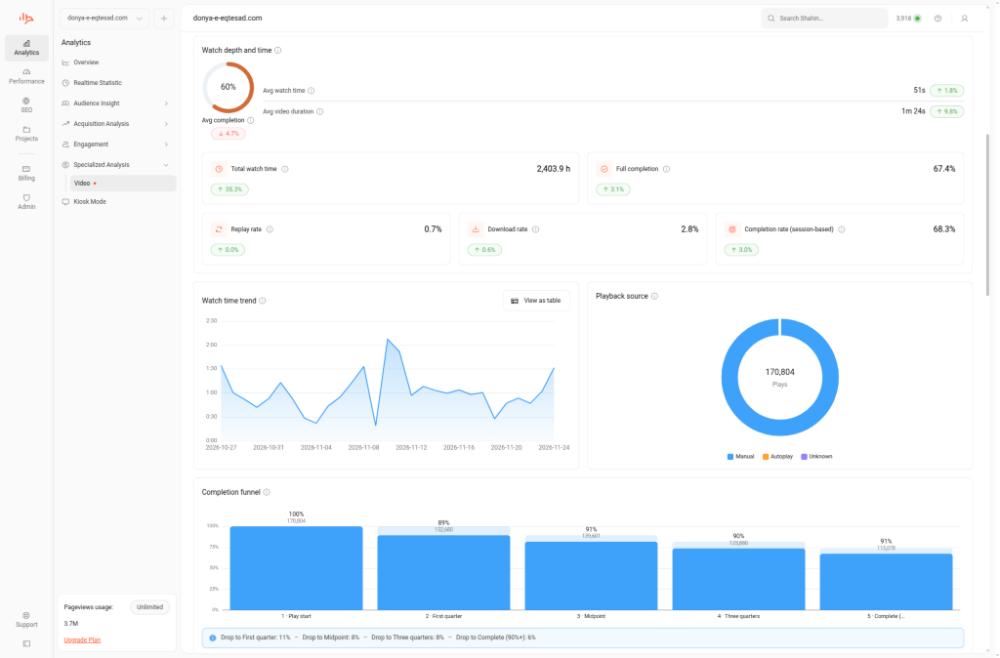

| Metric | Example Value | Definition & How to Interpret |
| :--- | :---: | :--- |
| **Avg completion** *(circular gauge)* | `60%` | Duration-weighted average watch depth: `Total watch time on duration-known plays / Sum of video durations across those plays`. Longer videos carry proportionally more weight. |
| **Avg watch time** | `51s` | Average real active watch time per play (`Total watch seconds / Total plays`). Always read this side-by-side with **Avg video duration**. |
| **Avg video duration** | `1m 24s` | Average length of the videos played in the selected range (reference baseline for Avg watch time). |
| **Total watch time** | `2,403.9 h` | Cumulative active watch time across all viewers in hours (`Total heartbeats × 10s / 3600`). |
| **Full completion** | `67.4%` | Share of **plays** that reached completion (`≥ 90%` or `ended`): `Completions / Plays`. Companion to Avg completion. |
| **Replay rate** | `0.7%` | Share of **unique users** who watched the same video again in a **separate session** within the selected range—a strong signal of evergreen or reference-value content. |
| **Download rate** | `2.8%` | Share of viewing sessions/plays in which the user clicked download to save the video for offline viewing. |
| **Completion rate (session-based)** | `68.3%` | Share of **video-playing sessions** in which at least one video was watched to completion (`Completed Sessions / Started Sessions`). Unlike Full completion (per-play), a user who watches 1 out of 2 videos in a session still counts as a completed session. |

---

### 3.4 Watch Time Trend & Exportable Table Drawer

Sitting on the left side of the two-column row below Watch Depth and Time *(see screenshot above)*, **Watch time trend** plots **day-by-day average watch time per play** across the selected window. This makes sudden drops (e.g., publishing shorter clips, player regressions, or viral bounce traffic) or spikes immediately visible against the multi-week baseline.

#### Viewing Daily Numbers & Exporting CSV
Click the **`View as table`** button in the top-right corner of the card to open the **Watch time trend** slide-over drawer:

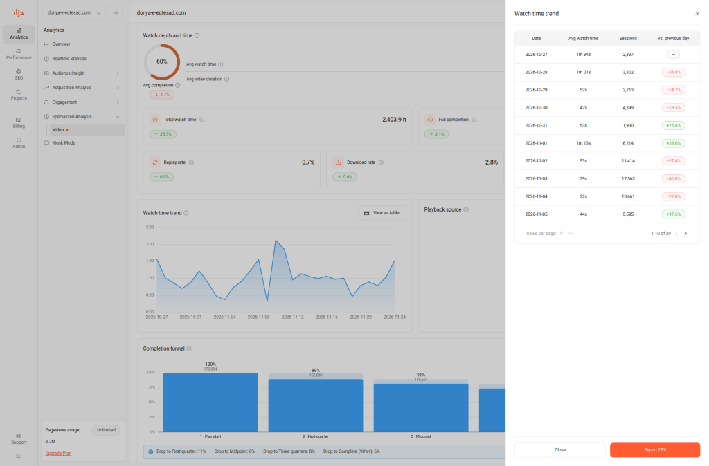

The drawer displays:
- **Date** — Each calendar day in the selected range.
- **Avg watch time** — Formatted average watch duration per play for that day (e.g., `1m 34s`, `52s`).
- **Sessions** — Number of video-playing sessions on that day.
- **vs. previous day** — Day-over-day percentage change badge (green for gains, red for drops).
- **Pagination** — Configurable rows per page (`10` by default).
- **`Export CSV`** — Downloads a clean `watch-time-trend.csv` file directly to your computer for spreadsheet reporting or BI imports.

---

### 3.5 Playback Source

Paired next to Watch Time Trend, the **Playback source** donut chart breaks down **how users initiated each play** and displays the total play count in the center (e.g., `170,804 Plays`).

Tracked start sources:
- **Manual** — The viewer actively clicked Play (user activation present).
- **Autoplay** — Playback began automatically without prior user interaction or via `autoplay` configuration.
- **Suggested** — Started from a recommended/related video prompt or playlist auto-advance.
- **Continue watching** — Resumed from a continue-watching entry point (when tagged via `data-shahin-playback-source`).
- **Unknown** — Source could not be classified.

#### Interactive Hover Tooltip
Hovering over any slice of the donut (or over the legend pills below it) highlights that segment and displays both its **share of total plays** and **that source's own completion rate**—letting you verify, for instance, whether autoplay plays finish at a much lower rate (`30.8%`) than manual plays (`66.3%`).

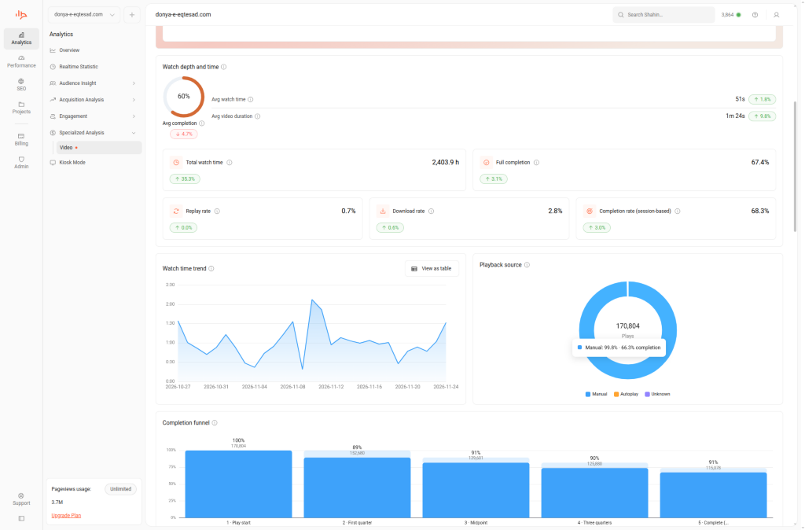

---

### 3.6 Completion Funnel

Displayed directly below the two-column row *(see [Watch Depth & Funnel screenshot](./images/03-watch-depth-trend-source-funnel.png))*, the **Completion funnel** visualizes audience retention across the five standard playback milestones:

1. **`1 · Play start`** (`100%` baseline — all started plays, e.g., `170,804`)
2. **`2 · First quarter`** (`25%` milestone — e.g., `152,680`)
3. **`3 · Midpoint`** (`50%` milestone — e.g., `139,601`)
4. **`4 · Three quarters`** (`75%` milestone — e.g., `125,880`)
5. **`5 · Complete (90%+)`** (`≥ 90%` or `ended` — e.g., `115,078`)

Each bar shows both the **step-to-step retention percentage** (light shaded ghost region indicating the drop from the prior step) and the **exact play count**. The blue summary banner beneath the chart spells out the drop at every boundary:

> *Example:* `Drop to First quarter: 11% – Drop to Midpoint: 8% – Drop to Three quarters: 8% – Drop to Complete (90%+): 6%`

- A steep drop before **First quarter** usually points to slow intros, weak hooks, mismatched thumbnails, or annoying pre-roll friction.
- A steady slope across all four quartiles indicates healthy, consistent pacing.
- *Technical note:* Because milestones are tracked per play as the playhead passes 25% / 50% / 75% / 90%, viewers scrubbing forward past an earlier milestone can occasionally cause a later step to be slightly higher than an earlier one on short or heavily scrubbed clips.

---

### 3.7 Completion Rate by Channel and Campaign

This horizontal ranked bar chart compares **session-based completion rate** across traffic acquisition channels (`Direct`, `Referral`, `Organic Search`, `Social`, `Email`) and **UTM campaigns**, answering: *"Which traffic sources bring viewers who actually finish watching?"*

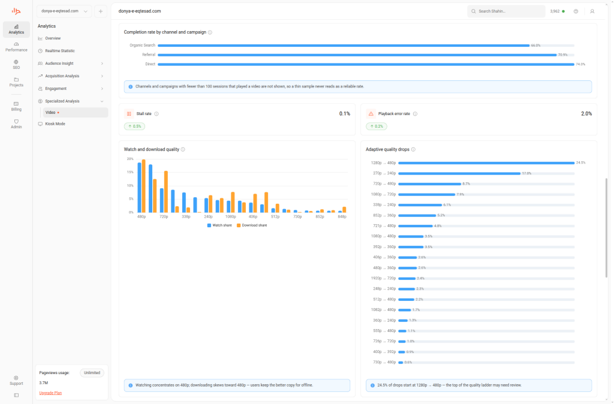

- **Formula per bar:** `Sessions with at least one completed video / Sessions with at least one video play × 100` (capped at `100%`).
- **Hover tooltip:** Displays exact completion percentage and total play sessions for that channel or campaign.
- **100-Session Statistical Floor:** Any channel or UTM campaign with **fewer than 100 video-playing sessions** in the selected date window is automatically excluded so thin samples never appear as misleading `95%` or `0%` bars. An info banner beneath the chart explains this rule (and names up to three excluded low-volume UTM campaigns if any exist in the period).

---

### 3.8 Playback Health (QoE), Quality Comparison & Adaptive Drops

Immediately below the channel completion chart *(shown in the screenshot above)* sits the **Streaming Quality of Experience (QoE)** suite—designed to help video engineers and ops teams spot player crashes, bandwidth mismatches, and encoding ladder issues.

#### 1. Playback Health KPIs (2 Cards)
- **Stall rate** (e.g., `0.1%`): Share of video-playing sessions where the player froze outright (playhead stuck for `≥ 5 seconds` while supposedly playing). More severe than normal buffering—usually signals a player bug, codec/muxing issue, or broken device/browser environment.
- **Playback error rate** (e.g., `2.0%`): Share of playback attempts (play intent or immediate error) that logged a fatal error **before rendering the first frame**—meaning the video never started at all.

#### 2. Watch and Download Quality (Left Chart)
A grouped column chart comparing every reported resolution/rendition (e.g., `480p`, `720p`, `338p`, `240p`, `1080p`, etc.) across two series:
- **Watch share (blue):** Share of total watch time (active heartbeats) spent streaming at each resolution.
- **Download share (orange):** Share of total video downloads saved at each resolution.
- **Interactive legend:** Click `Watch share` or `Download share` below the chart to isolate a single series (at least one series always stays active).
- **Auto-generated insight banner:** Summarizes which rendition dominates streaming versus offline downloads (for example, viewers streaming at `480p` on mobile networks while downloading higher resolutions for offline playback).

#### 3. Adaptive Quality Drops (Right Chart)
A ranked horizontal bar chart showing the most frequent **system-triggered adaptive bitrate (ABR) downgrade transitions** (e.g., `1280p → 480p` at `24.5%`, `270p → 240p` at `17.0%`, `720p → 480p` at `8.7%`, `1080p → 720p` at `7.9%`).
- Counts **automatic downgrades only** (`toQuality < fromQuality`, `trigger = adaptive`); manual user quality changes and upward upgrades are excluded.
- Hovering a bar shows the exact downgrade count and its share of all downgrades.
- **Auto-generated insight banner:** Highlights the #1 drop path (e.g., *"24.5% of drops start at 1280p → 480p — the top of the quality ladder may need review"*), signaling when your player's starting bitrate is too aggressive for your audience's real network bandwidth.

---

### 3.9 User Environment (Distribution & Trend)

The **User environment** card breaks down your **unique video viewers** (users who played at least one video in the selected range) across four technical dimensions while surfacing each segment's **Buffer rate** side-by-side.

#### Controls
- **Dimension pills (top left):** Switch between **`OS`**, **`Browser`**, **`Device`** *(default)*, and **`Brand`**.
- **View mode toggle (top right):** Switch between **`Distribution`** *(donut + breakdown table)* and **`Trend`** *(daily share line chart)*.

#### Distribution View
Shows a donut chart centered on **`Total unique users`** (e.g., `447,040`) next to an interactive breakdown table. Hovering a table row highlights its matching slice on the donut. The top 6 segments are shown individually, and any remaining long-tail values are pooled into **`Other`**.

| Column | Description |
| :--- | :--- |
| **Dimension** (`Device` / `OS` / `Browser` / `Brand`) | Color-coded segment name (e.g., `MOBILE`, `DESKTOP`, `BOT`, `TABLET`, `UNKNOWN`). |
| **Users** | Distinct users who started at least one video in this environment. |
| **Share** | Percentage of total unique video users plus a period-over-period share-change pill (`↑ 2.6%` / `↓ 2.6%`). |
| **Buffer rate** | Percentage of video-playing sessions in that environment that experienced buffering, color-coded by health severity: • **Green (`< 2.5%`):** Healthy playback • **Amber / Warning (`2.5% – 4.9%`):** Elevated buffering worth watching • **Red / Error (`≥ 5.0%`):** Problem environment needing investigation |

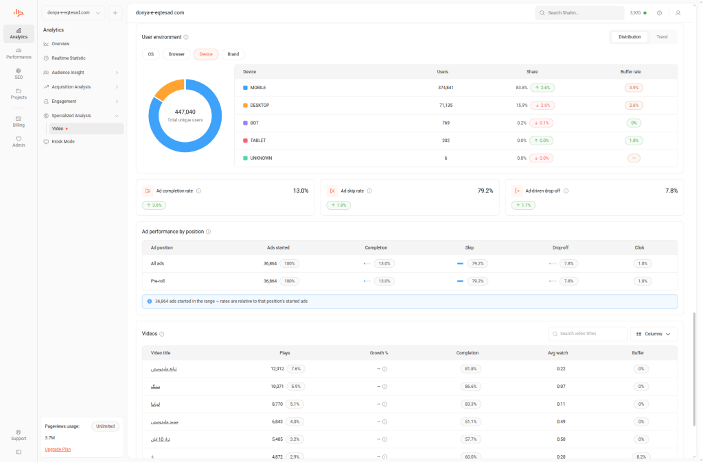

#### Trend View
Clicking **`Trend`** replaces the donut and table with a multi-series daily line chart showing each segment's **daily percentage share** over the selected date window (e.g., tracking whether mobile share spiked on weekends or shifted after an app release). Clicking legend entries toggles individual lines on or off.

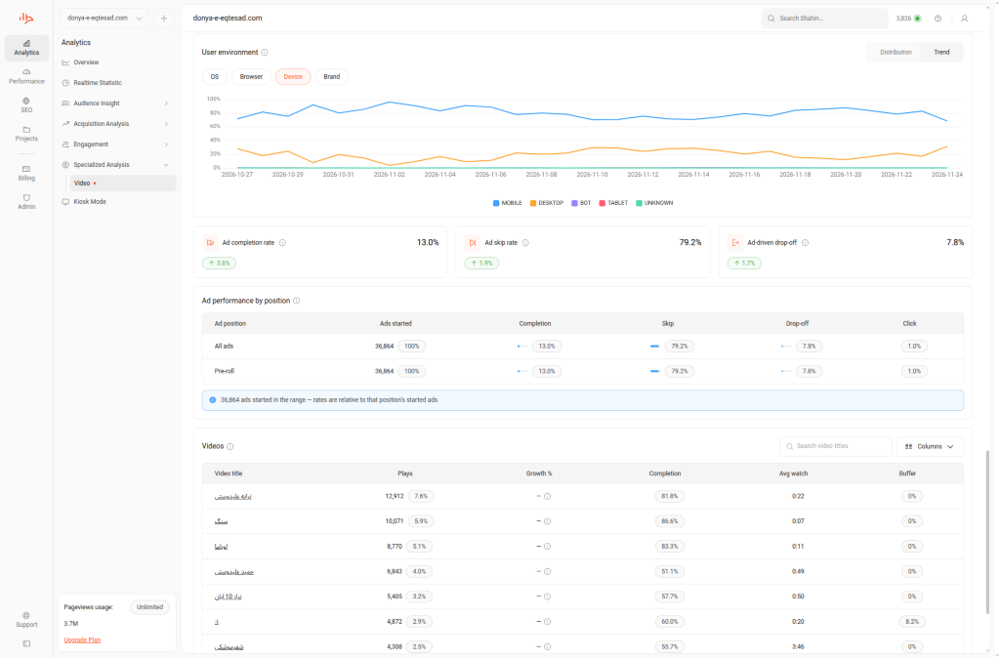

---

### 3.10 Ad Monetization & Ad Performance by Position

For publishers running in-stream video ads (tracked via Chakavak/APS, JW Player, or Google IMA SDK `ads_video_*` events—never page banner units), these two blocks measure revenue delivery against viewer abandonment.

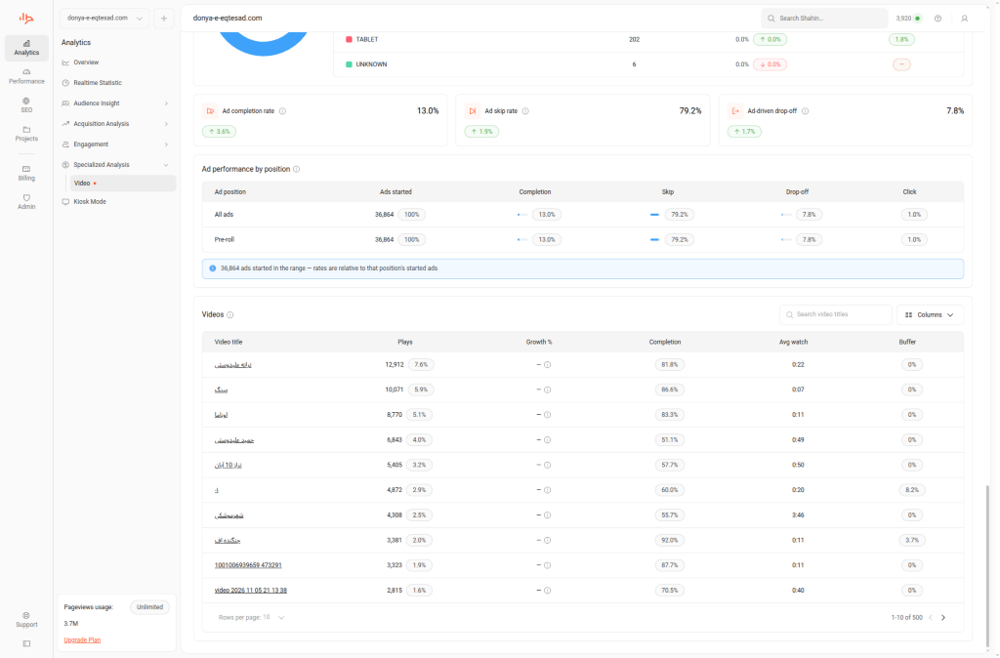

#### 1. Ad Monetization KPI Row (3 Cards)
| Card | Example | Definition |
| :--- | :---: | :--- |
| **Ad completion rate** | `13.0%` | Share of started ads watched all the way to the end. |
| **Ad skip rate** | `79.2%` | Skipped ads divided by all started ads (skippable or not). Indicates ad creative relevance and skip-timer behavior. |
| **Ad-driven drop-off** | `7.8%` | Share of started ads that were **neither completed nor skipped**—meaning the viewer abandoned the page/video during the ad (or the ad errored after starting). Unlike a skip (where the viewer continues to the content), drop-off means a lost viewer. |

> **Mutual Exclusivity Rule:** For every row, **Completion + Skip + Drop-off always sum to exactly `100%`** (calculated with largest-remainder rounding and outcome clamping). **Click rate** is tracked separately because a viewer can click an ad and still complete or skip it.

#### 2. Ad Performance by Position Table
Breaks down all started ads by break slot in chronological order: **`All ads`** (summary row), **`Pre-roll`**, **`Mid-roll`**, and **`Post-roll`** (only positions with started ads in the range are displayed).

- **Ads started:** Count and share of total started ads in the selected range.
- **Completion / Skip / Drop-off:** Mini progress bar + percentage pill, all relative to that position's started ads.
- **Click:** Percentage of started ads in that position that generated an ad click (e.g., `1.0%`).
- **Footer note:** Confirms total started ads across all positions in the range (e.g., *"36,864 ads started in the range — rates are relative to that position's started ads"*).

---

### 3.11 Videos Performance Table

At the bottom of the dashboard, the **Videos** table lists individual videos (up to the **top 500** by plays in the selected range) so you can compare titles side-by-side and drill into any specific clip.

#### Table Toolbar & Customization
- **Search (`Search video titles`):** Instant client-side filtering across video titles.
- **`Columns` Picker:** Lets you customize which metric columns are visible (preferences persist locally):
  - **Default columns (on by default):** `Plays`, `Growth %`, `Completion`, `Avg watch`, `Buffer`
  - **Optional columns (toggle on anytime):** `Replay rate`, `Stall rate`
- **Pagination:** Choose rows per page (`10` default) and navigate through all matched rows (`1-10 of 500`).

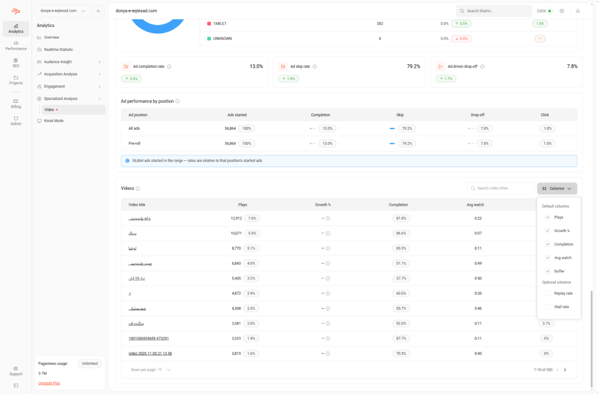

#### Column Reference
| Column | Details |
| :--- | :--- |
| **Video title** | Video's detected title (falls back to page title, `"Untitled video"`, or `"Unidentified videos"` for plays without an identifiable video key). Clicking a row opens the **Video Details** drawer. |
| **Plays** | Total plays started for this video plus its `%` share of **all content plays across the entire site** (not just the top 500 rows). |
| **Growth %** | Period-over-period play growth vs. the prior window. Displays `—` with an info tooltip when the video had no prior plays or fewer than 100 sessions (preventing noisy growth percentages on brand-new or tiny videos). |
| **Completion** | Per-play full completion rate (`Completions / Plays`). |
| **Avg watch** | Average real active watch time per play (`mm:ss`). |
| **Buffer** | Share of this video's started sessions that experienced buffering. |
| **Replay rate** *(optional)* | Share of unique users who watched this video in multiple sessions. For windows longer than 90 days, an `(est.)` indicator may appear; videos with too few users display `N/A`. |
| **Stall rate** *(optional)* | Share of this video's started sessions that stalled (`≥ 5s` frozen playhead). |

---

## 4. Per-Video Deep Dive: The Video Details Drawer

Clicking **any row** in the **Videos** table opens the **`Video details`** slide-over panel on the right side of the screen. Every metric shared with the main dashboard uses the **exact same formula**, guaranteeing full parity between the overview table and the single-video drawer.

The drawer is organized into **11 diagnostic sections** from top to bottom:

### Part 1 — Header, Video Trend, Overall Stats & Completion Funnel

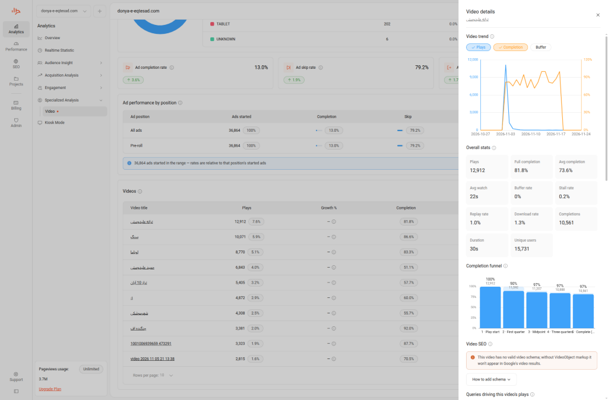

1. **Drawer Header:** Shows `Video details`, the clickable video title/link, and a close (`×`) button (there is also a `Close` button pinned to the drawer footer).
2. **Video trend:** A daily trend chart scoped exclusively to this video. Interactive pill toggles above the chart let you compare **`Plays`** (left Y-axis, counts), **`Completion`** (right Y-axis, `%`), and **`Buffer`** (right Y-axis, `%`) simultaneously—up to two units on dual axes.
3. **Overall stats (11 KPI Tiles):** Compact grid showing `Plays`, `Full completion`, `Avg completion`, `Avg watch`, `Buffer rate`, `Stall rate`, `Replay rate`, `Download rate`, `Completions`, `Duration`, and `Unique users`.
4. **Completion funnel:** The 5-stage play-start → 25% → 50% → 75% → Complete (`90%+`) funnel scoped to this single video (e.g., `12,912` starts → `10,561` completions).

---

### Part 2 — Video SEO Helper, Search Queries & Audience Retention

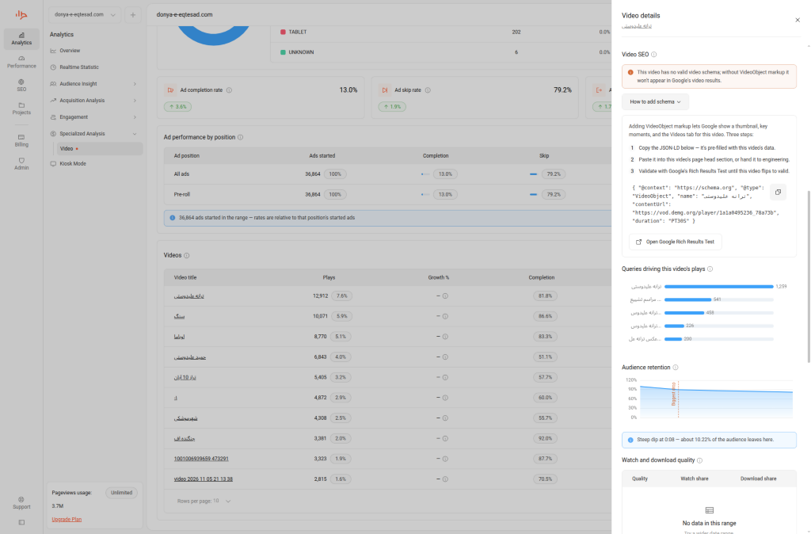

5. **Video SEO (`VideoObject` Schema Checker & Generator):**
   - Automatically checks whether the page hosting this video carries valid `application/ld+json` **`VideoObject`** structured data.
   - If valid schema is detected, shows a green confirmation banner.
   - If schema is missing, displays an amber warning banner (*"This video has no valid video schema; without VideoObject markup it won't appear in Google's video results."*) along with an expandable **`How to add schema`** guide containing:
     1. Three step-by-step instructions for content/engineering teams.
     2. A **ready-to-copy JSON-LD snippet** pre-filled with this video's detected `name`, `contentUrl`, and ISO-8601 `duration` (e.g., `"PT30S"`), complete with a one-click copy button.
     3. A direct **`Open Google Rich Results Test`** link (`https://search.google.com/test/rich-results`) to validate the markup after deploying it.
6. **Queries driving this video's plays:** Ranked horizontal bar chart of the Google Search queries estimated to have driven plays specifically for this video (sourced from Google Search Console).
7. **Audience retention:** Plots the percentage of viewers still watching across the video's timeline (derived from `0%`, `25%`, `50%`, `75%`, and `100%` milestones mapped onto the video's known duration).
   - Automatically marks the steepest step-to-step viewer loss with a vertical dashed **`Biggest drop`** annotation.
   - Displays a plain-language insight banner below the chart—for example: *"Steep dip at 0:08 — about 10.22% of the audience leaves here."*

---

### Part 3 — Per-Video Quality, Interactions, Device Split, Carrier Split & Seek Heatmap

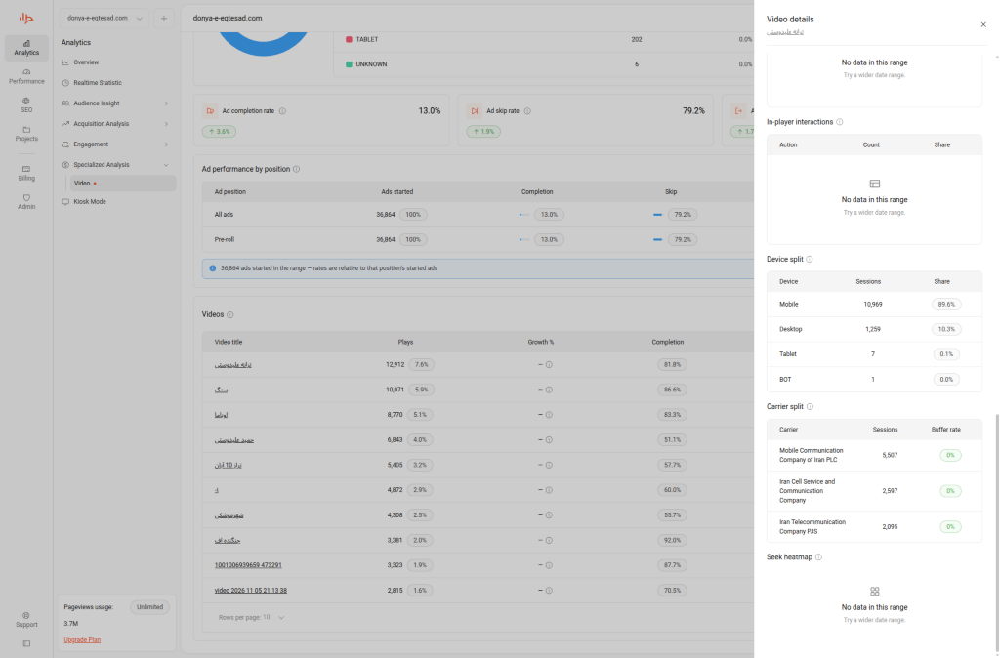

8. **Watch and download quality:** Per-resolution `Watch share` and `Download share` table for this video. When rendition data includes `360p`, Shahin also benchmarks this video's `360p` watch share against the **platform-wide trailing 7-day average**, flagging if this video's audience is watching on noticeably weaker networks.
9. **In-player interactions:** Table (`Action`, `Count`, `Share`) tracking how viewers use player controls on this video (such as seeking forward/backward, muting during playback, entering fullscreen, changing playback speed, and enabling subtitles). *Note: When no interaction data exists in the selected window or rollup for a video, it displays a clean empty state rather than zeroes.*
10. **Device split:** Table (`Device`, `Sessions`, `Share`) showing the session breakdown across `Mobile`, `Desktop`, `Tablet`, and `BOT` for this specific video.
11. **Carrier split:** Table (`Carrier`, `Sessions`, `Buffer rate`) breaking down playback sessions and color-coded buffer rate by ISP / mobile carrier (e.g., MCI, Irancell, TCI)—invaluable for diagnosing whether buffering is caused by one specific telecom network or CDN peering path rather than the video file itself.
12. **Seek heatmap:** Divides the video's timeline into **20 buckets (5% segments from `0%` to `95%`)** and plots where viewers seek most heavily, filterable by direction (**All**, **Backward**, **Forward**, **Mixed**) with an automatic hotspot summary:
    - A **backward seek hotspot** pinpoints a key, memorable, or confusing moment viewers re-watch.
    - A **forward seek hotspot** pinpoints a slow intro, sponsor read, or boring section viewers skip past.
    - *Note: Displays an empty state whenever no seek-bucket data is present in the selected range.*

---

## 5. Complete Page Interactions & UI Controls Reference

Every interactive control, hover state, modal, drawer, guard rule, and recovery action on the Video Dashboard page is cataloged below:

| Area | Control / Trigger | Exact Behavior & Feedback |
| :--- | :--- | :--- |
| **Global Header & Navigation** | **Project switcher** (top-left sidebar) | Switches active project, clears cached summary/environment data, re-checks video feature access, and reloads all cards. |
| **Global Header & Navigation** | **Date Range Selector** (top-right) | Opens popover with 7 presets (`Last 7 Days` → `Last 16 Months`) plus `Custom Range`. Selecting a preset syncs the URL query parameters, clears cached User Environment dimensions, and reloads every card. |
| **Global Header & Navigation** | **`Custom Range` calendar modal** | Clicking `Custom Range` opens a start/end calendar picker modal. Re-clicking `Custom Range` while a custom range is already active reopens the modal so you can edit the dates directly. |
| **All Cards & KPIs** | **`ⓘ` Info Tooltips** | Present next to every section heading, KPI label, `Source: Google Search Console` badge, and low-data `Growth %` (`—`) cell. Hovering/focusing displays a concise definition without cluttering the layout with raw formulas. |
| **Main Page Error State** | **`Try again` button** | If loading the dashboard fails, displays an error card (*"We couldn't reach the server. Event collection continues."*) with a `Try again` button that retries the query in place. |
| **Funnels & Ranked Bars** | **Bar hover** (*Organic Discovery*, *Queries*, *Completion Funnel*, *Channel Completion*, *Adaptive Drops*) | Hovering any bar displays exact counts, step drop-offs, session denominators (`Completion rate: X% from Y sessions`), or downgrade totals (`count drops · pct% of all drops`). |
| **Watch Time Trend** | **Line hover** | Moving across the X-axis displays a crosshair tooltip with the exact date and formatted average watch time (`m s`). |
| **Watch Time Trend** | **`View as table` button** | Opens the 560px **Watch time trend** slide-over drawer with daily rows, `vs. previous day` color-coded chips, `Rows per page` / `<` `>` pagination, **`Export CSV`** (downloads `watch-time-trend.csv` + shows `"Preparing your export…"` toast snackbar), and dismissal via **`Close`**, **`×`**, or backdrop click. |
| **Playback Source** | **Donut slice & legend hover** | Hovering either a donut slice OR any legend pill (`Manual`, `Autoplay`, `Unknown`, etc.) cross-highlights that slice and pops up a tooltip showing both `%` share of plays and that source's own completion rate `%`. |
| **Watch & Download Quality** | **Clickable legend (`Watch share` / `Download share`) & column hover** | Clicking a legend item hides/shows that series, with a **minimum-1-series guard** (deselecting the last visible series keeps it active). Hovering any resolution pair compares Watch share `%` vs. Download share `%`. |
| **User Environment** | **Dimension pills (`OS`, `Browser`, `Device`, `Brand`)** | Lazily fetches that dimension on first click (showing a brief skeleton transition) and caches it in memory until the date range or project changes. |
| **User Environment** | **View mode toggle (`Distribution` / `Trend`)** | Switches between the Donut + Breakdown Table (`Distribution`) and the multi-series daily share line chart (`Trend`). |
| **User Environment** | **Row-to-donut hover (`Distribution`) & Legend toggle (`Trend`)** | In `Distribution`, hovering any table row highlights the matching donut slice (and hovering a slice shows `{label} · {users} users · {pct}% share`). In `Trend`, clicking legend entries toggles lines with a minimum-1-active-series guard, and hovering along the timeline shows daily shares for all active segments. |
| **Videos Table** | **`Search video titles` input** | Instant live case-insensitive title search; automatically resets pagination to page 1. If no titles match, shows a `"No results"` empty state with a **`Clear search`** reset button. |
| **Videos Table** | **`Columns` picker dropdown** | Checkboxes grouped into **Default columns** (`Plays`, `Growth %`, `Completion`, `Avg watch`, `Buffer`) and **Optional columns** (`Replay rate`, `Stall rate`). Selections persist locally (`eventsVideo.videos`) across reloads. |
| **Videos Table** | **Pagination (`Rows per page`, `<` / `>`)** | Paginates across up to 500 ranked videos (default `10` rows/page). |
| **Videos Table** | **Row click / Title link** | Clicking a row opens the 480px **`Video details`** slide-over drawer for that video. Underlined titles visually indicate clickable items (and the drawer header displays the selected video's title/link). |
| **Video Details Drawer** | **`Video trend` metric pills (`Plays`, `Completion`, `Buffer`)** | Default state enables `Plays` + `Completion` (`Buffer` off). Multi-select with a **minimum-1-active-pill guard**. Automatically adapts between a **single Y-axis** (same unit) and **dual Y-axes** (left = count, right = `%`) when mixing `Plays` with rate metrics. Hovering shows a sorted multi-metric daily tooltip. |
| **Video Details Drawer** | **`Video SEO` → `How to add schema` accordion** | Smoothly expands/collapses the 3-step `VideoObject` guide (auto-collapses when switching to a different video). Clicking the **Copy icon** copies the pre-filled JSON-LD to the clipboard and temporarily switches the icon to a checkmark (`✓`). Clicking **`Open Google Rich Results Test`** opens `https://search.google.com/test/rich-results` in a new tab. |
| **Video Details Drawer** | **`Audience retention` hover** | Hovering any point along the retention area chart displays `Audience retained: X%` alongside the dashed `Biggest drop` vertical marker. |
| **Video Details Drawer** | **`Carrier split` buffer chips** | Color-codes carrier buffer rates using tighter diagnostic thresholds than the global environment table: **Green (`< 2%`)**, **Neutral (`2% – 2.9%`)**, **Red (`≥ 3%`)**, and **`—`** when session volume is too small. |
| **Video Details Drawer** | **`Seek heatmap` direction pills (`All`, `Backward`, `Forward`)** | When seek-bucket data is present, filtering by `Backward` or `Forward` **dims non-matching 5% buckets to 35% opacity** (keeping `Mixed` buckets visible) rather than hiding them, preserving timeline context. Hovering any bucket displays its `%` range, `Seek density %`, and `Dominant direction`. |
| **Video Details Drawer** | **Dismissal & Per-video error retry** | Closes via the top-right `×`, footer **`Close`** button, or backdrop click. If a single video's detail request fails, an inline **`Try again`** button retries just that video without reloading the whole page. |
| **Global Visual Adaptation** | **Theme (Light/Dark) & Locale (EN/FA)** | Every chart, tooltip, date label, number format, and RTL/LTR layout adapts automatically to the user's selected theme and language (including Persian digits and Jalali formatting in FA). |

---

## 6. Live Production Dashboard vs. Interactive Demo (v36)

This shareable package includes both **this guide (reflecting live production at `my.shahin.live`)** and the **official product PRD + interactive wireframe demo (`demo/video-dashboard/v36.html`)**. Because the wireframe demo represents the full product vision (including Report Builder bridge features and planned filters), a few elements differ slightly from what is live in production today:

| Capability | Live Production (`my.shahin.live`) | Interactive Demo (`demo/video-dashboard/v36.html`) |
| :--- | :--- | :--- |
| **Global filters** | Project switcher + Date Range Selector (7 presets + Custom Range) | Adds a full **Filters** slide-over drawer (Video, Category, Duration, Playback source, Device, Carrier, Location, Referrer, UTM, User type, Bot toggle) |
| **Hero KPIs** | 2 cards (`Videos viewed`, `Impression-to-play rate`) | 3 cards (also includes `Page engagement share`) |
| **Search Visibility** | `Organic discovery funnel` + `Queries driving plays` | Also shows `Index and schema health` ring gauges and disabled Report Builder bridge indicators |
| **Completion Funnel** | Overall 5-step funnel + stage drop-off banner | Adds a `By category` toggle (Education / Entertainment / News) |
| **User Environment** | `OS` / `Browser` / `Device` / `Brand` × `Distribution` / `Trend` | Adds `Group by version` toggle (for OS & Browser) and simulated error/retry demo state on Brand |
| **Ad Monetization** | 3 KPI cards (`Ad completion`, `Ad skip`, `Ad-driven drop-off`) + Position table | Adds 4th `CTA click rate` (`Next phase`) card |
| **Report Builder Integration** | Standalone Analytics page | Includes **"Open in Report Builder"** buttons on cards powered by the bundled Report Builder `v12` engine (`report-builder/rb-bridge.js`) and locked checklist for projects without video events |
| **Comparison Variants** | Single live version | Also bundles `v35` (conversion-mode framing), `v34` (lean QoE), and `v33` (includes dropped standalone Buffer KPI + CDN breakdown modal) |

---

## 7. Metric Formula & Definitions Reference

| Metric | Exact Formula / Logic | Unit | Data Source |
| :--- | :--- | :---: | :--- |
| **Videos viewed** | Distinct identified `video_id` values with ≥ 1 `video_started` | Count | On-page Video Pack |
| **Impression-to-play rate** | `video_started / video_impression × 100` | `%` | On-page Video Pack |
| **Organic Click-through (CTR)** | `GSC Clicks / GSC Impressions × 100` (matched video pages) | `%` | Google Search Console |
| **Organic Play-through** | `Estimated Search Plays / GSC Clicks × 100` | `%` | GSC + Video Pack |
| **Total watch time** | `(Total video_heartbeat count × 10 seconds) / 3600` | Hours (`h`) | On-page Video Pack |
| **Avg watch time** | `(Total video_heartbeat count × 10 seconds) / Plays` | Duration (`m s`) | On-page Video Pack |
| **Avg video duration** | `Sum(video_duration on plays with known duration) / Plays with known duration` | Duration (`m s`) | On-page Video Pack |
| **Avg completion** | `min(100, (Heartbeats on duration-known plays × 10s) / Sum(video_duration) × 100)` | `%` | On-page Video Pack |
| **Full completion** | `Completions (≥ 90% or ended) / Plays × 100` | `%` | On-page Video Pack |
| **Completion rate (session-based)** | `Sessions with ≥ 1 completion / Sessions with ≥ 1 play × 100` | `%` | On-page Video Pack |
| **Replay rate** | `Unique users who watched the same video in ≥ 2 separate sessions / Total unique video users × 100` | `%` | On-page Video Pack |
| **Download rate** | `Download sessions / Started sessions × 100` | `%` | On-page Video Pack |
| **Stall rate** | `Sessions with ≥ 1 video_stalled (playhead frozen ≥ 5s) / Started sessions × 100` | `%` | On-page Video Pack |
| **Playback error rate** | `Playback attempts that errored before first frame / Total playback attempts × 100` | `%` | On-page Video Pack |
| **Buffer rate** | `Sessions with ≥ 1 video_buffered / Started sessions × 100` | `%` | On-page Video Pack |
| **Ad completion rate** | `Clamped ad completions / Ads started × 100` | `%` | Video Ad Events (`ads_video_*`) |
| **Ad skip rate** | `Clamped ad skips / Ads started × 100` | `%` | Video Ad Events (`ads_video_*`) |
| **Ad-driven drop-off** | `(Ads started − Completed − Skipped) / Ads started × 100` | `%` | Video Ad Events (`ads_video_*`) |
| **Ad click rate** | `min(100, Ad clicks / Ads started × 100)` | `%` | Video Ad Events (`ads_video_*`) |

---

## 8. Practical Playbooks by Team

### Editorial & Content Teams
- **Spot weak openings fast:** Check **Completion funnel** (`Drop to First quarter`) globally, then open top clips in **Video details** to see the exact **Audience retention** `Biggest drop` timestamp.
- **Double down on winning topics:** Review **Queries driving plays** (both globally and per video) to see which search intents actually turn into video plays—and check **Replay rate** to spot evergreen reference content.
- **Compare manual vs. autoplay engagement:** Use **Playback source** to verify whether autoplay players are generating genuine watch depth or just empty starts with low completion.

### SEO Teams
- **Find the organic bottleneck:** In **Search visibility**, low **Click-through** means improving titles/thumbnails/rich snippets; strong Click-through with low **Play-through** means the video player is buried too far down the page or slow to load.
- **Fix missing video rich results in minutes:** Open top-performing videos in the **Videos** table, expand **Video SEO → How to add schema**, copy the pre-filled `VideoObject` JSON-LD snippet, hand it to engineering (or paste it into the page `<head>`), and validate it directly in Google's Rich Results Test.

### Video & Streaming Engineers
- **Tune your ABR encoding ladder:** If **Adaptive quality drops** concentrates heavily on one transition (e.g., `1280p → 480p`), lower your initial ABR bitrate estimate or add an intermediate rung so players stop overshooting and abruptly dropping.
- **Isolate playback failures vs. ISP congestion:**
  - High **Playback error rate** points to broken media URLs, CORS/DRM issues, or unsupported codecs before frame 1.
  - High **Stall rate** points to player/browser freezes.
  - High **Buffer rate** isolated to one row in **User environment** (`Device` / `OS` / `Browser`) or one telecom provider in **Carrier split** points to a device-specific or ISP/CDN peering bottleneck rather than a site-wide encoding problem.

### Ad Operations & Monetization Teams
- **Balance fill against viewer loss:** Monitor **Ad-driven drop-off** alongside **Ad completion rate** and **Ad skip rate**. A high skip rate signals creative fatigue or poorly matched ads (the viewer still watches your video afterward), whereas rising **Ad-driven drop-off** means pre-roll or mid-roll ads are actively driving viewers off your site before the content even plays.

---

## 9. Important Thresholds, Edge Cases & Notes

- **Minimum Sample Floors:**
  - *Completion rate by channel and campaign:* Excludes channels/campaigns with **< 100 video-playing sessions**.
  - *Videos table `Growth %`:* Displays `—` (with an info tooltip) when a video lacks a comparable prior-period baseline or has fewer than 100 sessions.
- **Empty States vs. Zeroes:** Whenever a section has no honest telemetry for the selected video, player, or date range (for instance, a player that doesn't report rendition height, or per-video interaction/seek-heatmap rollups without events in the window), Shahin intentionally renders a `"No data in this range · Try a wider date range."` empty state instead of fabricating `0%`.
- **Top-N Caps for Performance:**
  - **Videos table:** Lists up to the **top 500** videos by play count in the selected window; `%` share in the `Plays` column is still computed against **all** content plays on the site so shares are never artificially inflated.
  - **User environment:** Shows the **top 6** segments per dimension and aggregates the remainder into `Other`.
  - **Queries driving plays:** Displays up to the **top 6** search queries.
- **Google Search Console Lag:** Because GSC data typically trails by 2–3 days, very short ranges ending today (such as `Last 7 Days`) may show slightly lower GSC clicks relative to on-site plays, which can temporarily make **Play-through** look higher than usual.
- **Replay Windows Longer Than 90 Days:** Both sessions of a replay must occur inside the selected date window; for windows exceeding 90 days, per-video replay figures may be marked `(est.)`.
